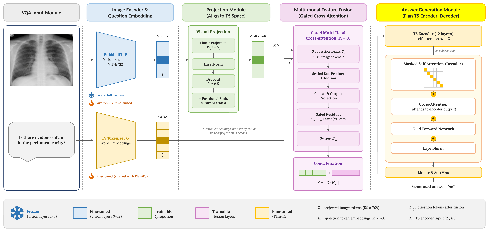

# CLIP-T5: A Hybrid Vision-Language Model for Medical Visual Question Answering

Code for the paper *CLIP-T5: A Hybrid Vision-Language Model for Medical Visual Question Answering*
(Asma Khan, Umair Rehman, Wonjong Noh), submitted to *Scientific Reports*.

CLIP-T5 answers clinical questions about medical images by generating free-text answers.

- **Image:** a medical CLIP encoder (PubMedCLIP, ViT-B/32) encodes the image into 50 patch tokens.
- **Fusion:** the patch tokens are projected into the T5 space, and the question tokens attend to them through gated multi-head cross-attention.
- **Answer:** a Flan-T5-base encoder–decoder generates the answer.
- **Training:** one model is trained jointly on VQA-RAD, SLAKE and PathVQA.



## Results

These are the official test sets, scored by exact match on the generated answers, as the mean ± standard deviation over three training runs. The full tables are in [`results/`](results/).

| Test set | Questions | Closed | Open | Overall |
|---|---|---|---|---|
| VQA-RAD | 451 | 66.3 ± 1.9 | 17.0 ± 0.9 | **46.7 ± 1.5** |
| SLAKE (English) | 1,061 | 86.3 ± 0.7 | 73.9 ± 0.5 | **78.0 ± 0.6** |
| PathVQA | 6,719 | 87.2 ± 0.5 | 27.1 ± 0.3 | **57.2 ± 0.3** |

Ablations (overall accuracy, %):

| Variant | VQA-RAD | SLAKE | PathVQA |
|---|---|---|---|
| Full model | 46.7 | 78.0 | 57.2 |
| Without cross-attention | 46.0 | 75.2 | 55.0 |
| Global image token only | 45.7 | 77.7 | 57.2 |
| Question only (no image) | 41.1 | 54.1 | 47.5 |
| Shuffled test images | 39.5 | 43.2 | 41.3 |

## Repository contents

| Path | What it is |
|---|---|
| `clip_t5.py` | Training and evaluation of CLIP-T5: main model and ablations, with statistics and tables |
| `scripts/original_clip_t5_corrected_eval.py` | The original CLIP-T5 of the first submission (frozen CLIP and T5, two global embeddings, trained on VQA-RAD only), re-evaluated with the same protocol |
| `scripts/make_example_figures.py` | Draws the figures of correct and incorrect example answers |
| `results/` | Final result tables used in the paper |
| `figures/` | Figures of the paper |

## Data

1. **VQA-RAD:** download the official release from the Open Science Framework (https://osf.io/89kps/). The folder must contain `VQA_RAD Dataset Public.json` and the image files. The script finds the file anywhere under `VQA_INPUT`.
2. **SLAKE and PathVQA:** downloaded automatically from the Hugging Face Hub (`mdwiratathya/SLAKE-vqa-english` and `flaviagiammarino/path-vqa`).

**Splits:**
- **VQA-RAD:** the official training and test sets. The paraphrased questions are used for training only. 10% of the training images, with all their questions, are held out as a validation set.
- **SLAKE and PathVQA:** the official splits. Validation uses at most 600 questions from the official validation set.
- **Image overlap:** the script reports how many VQA-RAD test questions use an image that also appears in training. This is 407 of the 451 test questions.

## How to run

You need a CUDA GPU. One training run takes about 100 minutes on an NVIDIA T4.

### On Kaggle (as used for the paper)

1. Create a notebook. Set the accelerator to **GPU T4 x1**, and turn **Internet** on.
2. Add the VQA-RAD release as a dataset input.
3. Paste `clip_t5.py` into one cell and run it.
4. Download `clip_t5_results.zip` from the output panel.

Kaggle stops a session after 12 hours. The script stops starting new runs after 11 hours, and skips finished runs when it is started again.

### Locally

```bash
pip install -r requirements.txt
export VQA_INPUT=/path/to/vqa-rad      # folder with "VQA_RAD Dataset Public.json" and the images
export VQA_WORK=/path/to/output
export RUNS="main:0,1,2 no_xattn:0,1,2 question_only:0,1 cls_only:0,1"   # default
python clip_t5.py
```

`RUNS` lists the variants and seeds to train. The variants are:
- `main`: the full model;
- `no_xattn`: without cross-attention;
- `question_only`: without the image;
- `cls_only`: global image token only.

Every `main` run also does the shuffled-image test. The first `main` run also exports examples and measures latency.

## Evaluation protocol

- **Answers:** generated with beam search (beam size 5), without access to the reference answer.
- **Normalization:** answers are lower-cased; punctuation and articles are removed; number words are mapped to digits; spelling variants are unified (e.g., "x-ray" and "xray").
- **Exact-match accuracy** is the main metric.
- **Lenient accuracy** also accepts answers from a fixed list of medical synonyms and, for open questions, answers whose words contain each other. Yes/no answers must always match exactly. The synonym list is in `clip_t5.py`.
- **Token F1** is also reported.
- **Statistics:** the mean ± standard deviation over runs; Welch's t-test between variants; a chi-square test across the VQA-RAD question types.

## Training settings

| Setting | Value |
|---|---|
| Image encoder | `flaviagiammarino/pubmed-clip-vit-base-patch32`, first 8 layers frozen, last 4 fine-tuned |
| Language model | `google/flan-t5-base`, fully fine-tuned |
| Trainable parameters | about 279M |
| Optimizer | AdamW, weight decay 0.01; learning rates 1e-4 (T5), 2e-5 (vision layers), 5e-4 (new layers) |
| Schedule | cosine, 5% linear warm-up, 12 epochs × 800 steps, batch size 16, gradient clipping 1.0 |
| Data sampling | the three datasets are sampled in proportion to the square root of their sizes |
| Model selection | best mean validation accuracy (greedy decoding), early stopping with patience 3 |
| Augmentation | 2 precomputed views per training image: random resized crop (0.8–1.0), rotation ±10°, brightness/contrast 0.2; no flips |
| Seeds | 0, 1, 2 |

## Citation

```bibtex
@article{khan2026clipt5,
  title   = {CLIP-T5: A Hybrid Vision-Language Model for Medical Visual Question Answering},
  author  = {Khan, Asma and Rehman, Umair and Noh, Wonjong},
  journal = {Scientific Reports (under review)},
  year    = {2026}
}
```

## License

MIT; see `LICENSE`. The datasets keep their own licenses.
